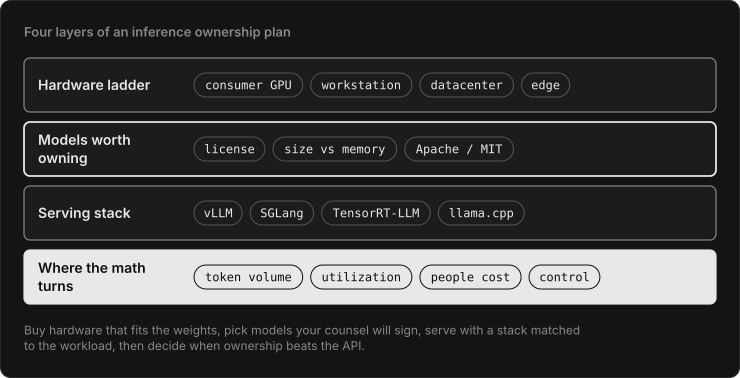

*Last week, in [When the Model Comes to the Data](/2026/07/when-the-model-comes-to-the-data/), I argued that inference is moving to where the data lives. This week I want to lay out the map you would need to actually make that move.*

What follows is the four-layer inventory I would want in front of me if I were deciding, this quarter, whether to shift real workloads off token-metered APIs and onto hardware I control: what to buy, what to run on it, what to serve it with, and where the math turns. Everything here is sourced as of mid-July 2026, and I have flagged the numbers most likely to drift, because in this market they drift fast.

### Layer 1: the hardware ladder

The ladder has four tiers, and each one earns its place with a different job.

| Tier | Representative hardware | Memory | Rough cost (July 2026) | What it serves |
|---|---|---|---|---|
| Consumer | RTX 5090 | 32 GB GDDR7 | $2,000 MSRP, [over $4,000 spot](https://www.compute-market.com/blog/gpu-market-trends-pricing-2026) | Sub-30B models, single team |
| Workstation / prosumer | Mac Studio M3 Ultra 256 GB; DGX Spark | 128 to 256 GB unified | [$5,999+](https://insiderllm.com/guides/m4-max-ultra-local-llms-apple-silicon/); [$4,699](https://www.ajeetraina.com/nvidia-dgx-spark-vs-jetson-agx-thor-which-one-should-you-buy/) | 70B dense, 100B+ MoE, department scale |
| Datacenter | A100 80 GB; H100/H200; B200 | 80 to 192 GB HBM | ~$15k; [$25k to $40k](https://siliconanalysts.com/analysis/nvidia-gpu-prices-double-as-ai-demand-overwhelms-supply-chain); [$30k to $40k in 8+ clusters](https://www.thundercompute.com/blog/nvidia-b200-pricing) | Frontier-class open weights, org scale |
| Edge / embedded | Jetson AGX Thor 128 GB | 128 GB | [$3,499 dev kit](https://www.hackster.io/news/nvidia-tells-resellers-to-open-jetson-agx-thor-developer-kit-orders-at-3-499-06e8cbf52441) | 20B to 120B at the physical edge |

There are three things the spec sheets will not tell you. First, the memory squeeze is the story of 2026: the RTX 5090 has [doubled off its MSRP](https://www.compute-market.com/blog/gpu-market-trends-pricing-2026) in the spot market, NVIDIA raised the DGX Spark from $3,999 to $4,699 in February citing memory supply, and Apple withdrew the 512 GB Mac Studio configuration entirely during the DRAM shortage. Every price in the table above is a snapshot, and prices have been moving fast, rarely in the buyer's favor. Second, the B200 is real but rationed: 192 GB of HBM3e and 8 TB/s of bandwidth, [effectively hyperscaler-allocated](https://www.thundercompute.com/blog/nvidia-b200-pricing) with 3-to-6-month lead times for everyone else. That memory is what you are paying for: a 70B model at full FP16 precision needs about 140 GB of weights, too large for an 80 GB H100 to hold, while the B200's 192 GB [fits several quantized copies of the same model side by side](https://www.spheron.network/gpu-rental/b200/). Third, do not overlook the Mac in the middle tier. The M3 Ultra's 800 GB/s of unified memory bandwidth runs DeepSeek-class 671B MoE models at 4-bit around [20 tokens per second via MLX](https://insiderllm.com/guides/m4-max-ultra-local-llms-apple-silicon/), which is a strange and useful fact for a department that wants big-model quality without a datacenter procurement cycle.

The sizing rule of thumb goes like this: FP16 needs 2 bytes per parameter, INT4 needs half a byte, and [actual usage runs 10 to 20% higher](https://www.morphllm.com/best-open-source-llm) for KV cache and framework overhead. A 70B model is 140 GB at FP16 and roughly 35 GB at 4-bit. That arithmetic, more than any benchmark, decides what you can own.

### Layer 2: the models worth owning

Start with the license. For example, Apache 2.0 and MIT tend to clear the first hurdle quickly, community licenses are what get legal teams digging deeper.

| Model | Size | License | Realistic hardware |
|---|---|---|---|
| Qwen3-235B-A22B | 235B MoE | Apache 2.0 | 4x A100 80 GB (~$60k) |
| Qwen3-Coder-480B | 480B MoE | Apache 2.0 | B200 class / multi-node |
| DeepSeek R1 / V4 line | 671B MoE | MIT | Multi-GPU HBM, or M3 Ultra at 4-bit |
| GLM-5.2 | ~350B class | MIT | 6x A100 class |
| Kimi K2.5 | ~1T MoE | Modified MIT | 16x A100 (~$240k), the deep end |
| gpt-oss-120b | 120B MoE | Apache 2.0 | 2x A100, or 1 H100/B200 |
| Gemma 4 12B | 12B | Apache 2.0 | 16 GB laptop or single consumer GPU |
| Devstral Small 2 | 24B | Apache 2.0 | Single RTX 4090 / 32 GB Mac |
| Ministral 3 family | 3B / 8B / 14B | Apache 2.0 | Edge and embedded |

Several of these are worth expanding on. [Qwen3-Coder-480B posts 69.6% on SWE-bench Verified](https://huggingface.co/blog/daya-shankar/open-source-llms) under Apache 2.0, which as of this writing is the strongest coding result you can legally own outright. [Devstral Small 2 posts 68%](https://pinggy.io/blog/best_open_source_self_hosted_llms_for_coding/) at 24B parameters on a single consumer card. A model one-twentieth the size giving up less than 2 points on the same benchmark suggests that much of the everyday coding workload no longer needs a giant model at all. DeepSeek's MIT license [explicitly permits distillation](https://github.com/eugeneyan/open-llms), which matters if your plan includes training smaller in-house models on its outputs. I left Llama 4 off the table deliberately. The models are capable, and the Scout variant's 10M-token context window is real, but the community license carries acceptable-use terms your counsel needs to actually read. The open-weight tier as a whole now trails the closed frontier by [roughly 3 to 6 months](https://openrouter.ai/blog/insights/the-open-weight-models-that-matter-june-2026/), a gap that has held steady rather than widened for 18 months.

One caution before moving on: the model landscape moves much faster than the hardware market. New open-weight releases land constantly, and a table like the one above starts going stale the day it is published. Treat it as a starting point, and verify against the current leaderboards before you commit.

### Layer 3: the serving stack

The runtime landscape consolidated meaningfully this year. HuggingFace [put TGI into maintenance mode](https://theaiengineer.substack.com/p/vllm-vs-ollama-vs-sglang-vs-tensorrt), and its own README now points users to vLLM, SGLang, and llama.cpp instead.

**vLLM** is the production default and the right starting point absent a specific reason otherwise. PagedAttention keeps GPU memory from being wasted on empty KV-cache slots, it runs on the widest range of hardware, and its operational surface is well understood. **SGLang** earns its place when requests share context: RadixAttention caches shared prefixes across requests, and on agent and RAG workloads it [beats vLLM by around 29% on throughput](https://www.spheron.network/blog/vllm-vs-tensorrt-llm-vs-sglang-benchmarks/). Agentic workloads consume 5 to 30x more tokens per task than a chatbot, so a throughput edge on shared-context traffic compounds quickly. **TensorRT-LLM** extracts the most from NVIDIA silicon and costs you [1 to 2 weeks of engineering setup](https://leetllm.com/blog/llm-inference-engine-comparison-2026) plus vendor lock-in; it makes sense at the scale where single-digit efficiency points pay a salary. **llama.cpp** and **Ollama** are the laptop and prototype tier: point them at a GGUF file and you have a model running in minutes, but neither is built for multi-user production.

You will also need an opinion on quantization. FP8 is the default serving precision on Hopper-class hardware, FP4 is the headline feature of the Blackwell generation, and 4-bit GGUF or AWQ is what makes the consumer and Mac tiers viable at all. My feeling is that quantization policy belongs in the plan itself: know which of your models degrade acceptably at 4-bit before the hardware order goes out. Above the engine sits orchestration, and here the Kubernetes patterns you already run apply: vLLM or SGLang pods behind a router, KServe or Ray Serve if you want the abstraction, NVIDIA Dynamo if you have committed to that ecosystem.

### Layer 4: where the math turns

The crossover against frontier APIs currently lands near [2 to 5 million tokens a day](https://www.sitepoint.com/self-hosted-llm-costs-2026/) on reserved capacity over a 12-month window. Below it, stay on the API. Above it, the arithmetic favors ownership and improves with every month of sustained volume; sub-30B deployments on consumer hardware have shown [break-even inside 3 months](https://arxiv.org/html/2509.18101v3) when kept busy.

Three costs hide outside that arithmetic. Utilization comes first: a GPU at 10% load costs up to 10x more per token than one near capacity, and idle private clusters are the most common way this whole strategy fails. Then come people, and you should budget [20 to 30% of a senior engineer](https://www.sitepoint.com/self-hosted-llm-costs-2026/), roughly $3,000 to $6,000 a month, for the serving stack, model upgrades, and the pager. The last one is drift: against aggressively priced hosted models, a poorly utilized cluster stretches break-even to [5 to 9 years](https://arxiv.org/html/2509.18101v3), which is a polite way of saying never.

What the spreadsheet cannot price is the control column: inference that runs inside your audit boundary, data that never crosses a provider's terms of service, latency tails you own end to end, and immunity from the rate limit and the repricing email. For regulated workloads, that control is usually why the spreadsheet got opened in the first place.

### The short version

Start on the API and instrument your token consumption honestly; without that data you will never see the crossover coming. When sustained volume clears a few million tokens a day, price a pilot: one workstation-tier box or a 2x A100 node, an Apache-licensed model matched to the workload, vLLM in front of it, routed behind the same gateway your API traffic uses. Keep the frontier API as the gated escape hatch for the reasoning tasks your local models cannot handle. Treat utilization as a first-class SLO from day one. And revisit the model choice regularly, because the 3-to-6-month lag means the frontier capability you rent today keeps arriving in ownable form a couple of quarters later.

The stack will keep churning underneath these numbers. The direction it points, intelligence moving closer to the data and the people who answer for it, has been steady for 2 years now, and you and I both know infrastructure follows accountability in the end.

And life goes on...
